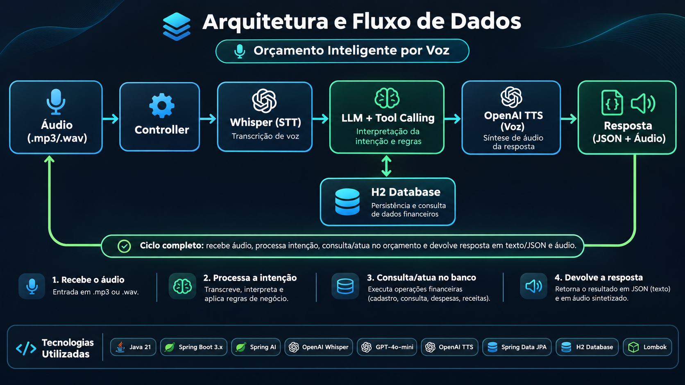

# 🎙️ Orçamento Inteligente por Voz

**API REST para registrar e consultar finanças pessoais a partir de comandos de voz, usando Spring AI e OpenAI.**

## 📖 Sobre o Projeto

O **Orçamento Inteligente por Voz** é uma API REST que transforma comandos de áudio em operações de finanças pessoais. A aplicação transcreve o áudio com o **OpenAI Whisper**, interpreta a intenção do usuário com o **GPT-4o-mini** e utiliza **Tool Calling** para registrar receitas, despesas ou consultar o saldo.

Após processar o comando, a API devolve a transcrição, uma resposta em texto e o áudio sintetizado pelo **OpenAI TTS**, codificado em Base64. As transações são persistidas em um banco **H2** em memória.

## 🚀 Tecnologias Utilizadas

| Tecnologia | Finalidade |
| --- | --- |
| Java 17 | Linguagem e versão configurada no projeto. |
| Spring Boot 3.3.4 | Base da API REST e da configuração da aplicação. |
| Spring AI 1.0.0-M2 | Integração com os modelos da OpenAI e Tool Calling. |
| OpenAI Whisper (whisper-1) | Transcrição de áudio para texto (Speech-to-Text). |
| GPT-4o-mini | Interpretação de comandos em linguagem natural e escolha das ferramentas. |
| OpenAI TTS (tts-1) | Síntese da resposta textual em áudio. |
| Spring Data JPA | Persistência e consultas das transações. |
| H2 Database | Banco de dados em memória para os dados financeiros. |
| Lombok 1.18.34 | Redução de código repetitivo nas classes Java. |

> O pom.xml atual define Java 17. Por isso, o README não declara Java 21, embora essa seja uma referência presente na arte de arquitetura.

## 🏗️ Arquitetura e Fluxo de Dados

O endpoint recebe um arquivo de áudio e o encaminha ao serviço de transcrição. O texto resultante é enviado ao ChatClient, que pode acionar as ferramentas de registro ou consulta de saldo. Essas ferramentas utilizam os serviços e o H2 para acessar as transações; por fim, a resposta textual é convertida em áudio e retornada em JSON.

## ✨ Funcionalidades

- Registro de receitas por comando de voz.
- Registro de despesas por comando de voz.
- Consulta do resumo de saldo, receitas e despesas.
- Interpretação de comandos em linguagem natural em português brasileiro.
- Transcrição do áudio enviado e geração de resposta em texto.
- Geração de áudio para a resposta, retornado em Base64.
- Listagem das transações persistidas.

📚 **Documentação completa:** [Acessar Wiki](https://github.com/Evertongean/orcamento-inteligente-voz/wiki)
